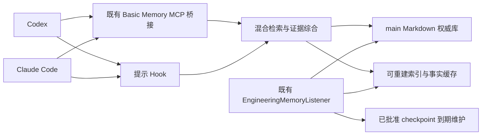

# Context Bridge

[](https://m8ven.ai/mcp/wblxr408-context-bridge-1g1nhf?s=readme)

**为 Codex 和 Claude Code 提供可恢复的任务交接、有出处的长期记忆，以及 checkpoint 的摘要、隔离、恢复和到期删除。**

Context Bridge builds resumable task handoffs and evidence-backed personal memory on top of an existing Basic Memory installation. Codex and Claude Code share the same Markdown knowledge base, MCP bridge and background listener.

项目在既有 Basic Memory `main` 上增强检索、事实历史、知识页和任务连续性。Markdown 是权威知识源；SQLite、向量及派生页用于索引和缓存。后台复用原 `EngineeringMemoryListener`，前台通过现有 MCP 和提示 Hook 接入两客户端。

项目支持 **Codex 和 Claude Code**。截至 **2026-10-13**，本地部署完成，最终 **87 项功能回归通过**；两端实际 MCP 配置、30 秒 Hook、checkpoint 恢复和原监听任务的真实到期删除已经验收。Claude 原生模型验收时，其模型渠道返回 **503**，该次调用未得到成功结果；这是渠道服务可用性问题。具体证据见[完整验收记录](docs/checkpoint-lifecycle验收.md)和[结构化证据](docs/checkpoint-部署端到端验收.json)。

## 能解决什么

- 长任务跨会话时，保存目标、约束、完成证据、失败原因和下一步，并通过精确 cursor 恢复。
- 中文历史问题通过字词 BM25、多语向量、重排与有限关系扩展检索，返回可回读的来源。
- 对来源明确的事实保留原文、角色、时间和修改历史；观察及知识页可从权威笔记重建。
- 反思回答综合当前证据并提供出处；无来源或额度不足时明确返回限制。
- Codex 与 Claude Code 按当前问题和工作目录注入相关记忆，同会话重复资料抑制。
- 旧 checkpoint 先形成历史摘要、退出当前上下文，再隔离和到期删除；仍能恢复隔离原件或读取删除后的墓碑。

## 功能与入口

| 功能 | 实现与使用方式 |
| --- | --- |
| 任务交接 | `context-bridge/` 技能；目标、需求版本、所有权与交接回执 |
| 混合检索 | MCP `memory_recall`；项目范围、时间过滤、来源去重、历史显式开启 |
| 有出处的反思 | MCP `memory_reflect`；当前事实与原文支持，复用模型预算 |
| 持续知识页 | MCP `memory_knowledge_page`；来源变化标记过期，支持刷新 |
| 自动记忆 | 原监听器处理 Codex/Claude 记录；前台工程记忆技能负责明确的持久决策 |
| 提示注入 | 原生 `UserPromptSubmit` Hook；当前问题、cwd 和重复抑制 |
| 历史补录 | CLI `backfill`、`import-document`、`import-git`；补录入队后渐进处理 |
| checkpoint 生命周期 | CLI `checkpoint-plan/apply/restore/purge`；复用原任务维护周期 |
| 本地升级和恢复 | `install.py`、`install_checkpoint.py`；停写锁、代码配置备份和恢复 |

## 架构



默认嵌入采用多语 MiniLM，重排采用 BGE；自动 Hook 重排 8 个候选供 4 个注入槽位，普通 MCP 默认重排 20 个。历史摘要不进入当前反思、知识页和自动上下文；明确使用 `include_history=true` 才纳入历史召回。

## 环境与安装

当前部署脚本针对 **Windows + Python 3.12**。验收运行环境使用 Basic Memory **0.23.2**、FastEmbed **0.8.1**；已记录的依赖见 [requirements.txt](requirements.txt)。

这是对既有个人记忆安装的升级。运行安装脚本前，目标机器需要已有：

1. Basic Memory 的 `main` 项目和本地 Markdown 知识库。
2. `~/.codex/services/engineering-memory` 的配置、状态数据库和 `EngineeringMemoryListener` Windows 任务。
3. Codex、Claude Code 各自已配置的本地 Basic Memory stdio MCP 路由。
4. 用于模型归纳的原有 Codex 登录，以及可使用的多语模型缓存。

仓库不提供全新主机的一键初始化器。它保留既有项目、配置、监听器和预算，在这个基础上升级。

克隆后，在仓库根目录使用 Basic Memory 所在的 Python 环境：

```powershell
git clone https://github.com/wblxr408/context-bridge.git
cd context-bridge

$MemoryPython = Join-Path $HOME 'AppData/Roaming/uv/tools/basic-memory/Scripts/python.exe'
uv pip install --python $MemoryPython -r requirements.txt
```

MCP、Hook 和后台任务必须使用这个安装了 Basic Memory 与 FastEmbed 的同一环境。只指向另一个没有这些依赖的 Python，会在真实请求中报依赖错误。

完整增强升级与 checkpoint 专项升级：

```powershell
& $MemoryPython install.py
# 已具备增强检索与监听器、仅升级 checkpoint 时使用：
& $MemoryPython install_checkpoint.py
```

脚本取得原监听锁后更新代码和配置，再恢复原任务；备份保留在执行目录。完成后重连客户端中的 `basic-memory`，使新进程加载新代码。作者本机已部署，无需因克隆仓库重复安装。

恢复先前完整安装：

```powershell
& $MemoryPython install.py --restore '<backup-directory>'
```

该恢复入口适用于 `install.py` 生成的完整备份。checkpoint 专项部署失败时，安装器按其专项备份恢复；不要将不同备份格式混用。

## 日常使用

通过已连接的 MCP 调用：

```json
{
  "tool": "memory_recall",
  "arguments": {
    "query": "这个项目上次决定采用什么方案？",
    "scope": "C:/work/my-project",
    "limit": 5
  }
}
```

来源可用 Basic Memory 的 `read_note` 精确回读。历史问题需在召回参数中明确设置 `include_history: true`。

前台 CLI 使用已部署服务路径：

```powershell
$Service = Join-Path $HOME '.codex/services/engineering-memory'
$MemoryCli = Join-Path $Service 'app/memory_cli.py'
$Scope = (Get-Location).Path

& $MemoryPython $MemoryCli recall '之前的验收约定' --scope $Scope
& $MemoryPython $MemoryCli reflect '目前采用的方案和理由是什么？' --scope $Scope
& $MemoryPython $MemoryCli page '项目开发约定' --name '项目开发约定' --scope $Scope
```

补录历史和材料：

```powershell
& $MemoryPython $MemoryCli backfill --source '<configured-log-directory>' --kind codex
& $MemoryPython $MemoryCli import-document --source '<workspace/document.md>' --scope $Scope
& $MemoryPython $MemoryCli import-git --scope $Scope --limit 50 --after 2026-01-01
```

历史补录只从已配置的来源读取；入队表示等待处理。分类和反思沿用原预算：每小时 2 次、每天 8 次、每天 60000 tokens，单次预留 12000。不会因重新安装清空预算账本。

## checkpoint 删除规则

| 通道 | 默认规则 |
| --- | --- |
| 普通 | 原件至少 24 小时，审核隔离后保留 72 小时 |
| 快速 | 明确批量请求可免等原件年龄；默认隔离 60 分钟 |
| 数量 | 同任务超过 8 份目标保留 3 份；同 cwd 超过 20 份目标保留 10 份，保护规则优先 |

最新恢复点、固定、使用中、原件依赖、未知身份/时间/目录，以及未完成覆盖审核的来源均受保护。`--active-session` 可明确保护活动聊天。

删除按以下顺序推进：

1. 为精确来源编写覆盖审核及读者核对依据，生成计划。
2. 写入每组历史摘要并回读；使用固定 tokenizer 计量完整 Markdown，上限 2000 tokens。
3. 原件移动到隔离区，退出当前召回，增量协调原生索引；同步失败时阻止永久删除。
4. 隔离期内精确 cursor 可回读原件，恢复后自动固定。
5. 原监听任务在真实期限后重新核对保护和摘要版本，删除原件；旧 cursor 返回墓碑及摘要链接。

```powershell
& $MemoryPython $MemoryCli checkpoint-plan --review review.json --lane fast --fraction .8 --active-session '<session-id>'
# 将返回的计划保存为 plan.json，按计划准备并审核 drafts.json。
& $MemoryPython $MemoryCli checkpoint-apply --source plan.json --drafts drafts.json
& $MemoryPython $MemoryCli checkpoint-restore '<exact-permalink>'
```

原监听器启动时立即处理已到期的批准项，随后按既有 300 秒周期维护；它不会自行批准新的原件删除。隔离暂存原件，实际到期删除才释放对应原件空间。详细审核字段、摘要修订事务和失败处理见 [checkpoint 生命周期](context-bridge/references/checkpoint-lifecycle.md)。本规则管理 Basic Memory 原件；local bundle retention 是另一条显式工作流。

## 验证与已知边界

最近一次实际完整回归：**87 项，87.040 秒，OK**，包含真实多语嵌入、重排与 stdio MCP。复现功能回归：

```powershell
$env:MEMORY_E2E_MODELS = 'true'
& $MemoryPython -m unittest discover -s tests -v
```

以下入口执行真实客户端业务，会创建专用验收数据、操作隔离并清理自己创建的测试记录；需要既有安装和本地写权限：

```powershell
& $MemoryPython accept_hook.py
& $MemoryPython accept_checkpoint_installed.py
```

两端实际 MCP、Hook、恢复和真实到期删除已通过；到期验收由原监听任务执行，不伪造时间。专用验收隔离期为 1 分钟，正式默认仍 60 分钟。完整证据见 [checkpoint 部署验收 JSON](docs/checkpoint-部署端到端验收.json)。

需要保留的限制：

- Claude Code 已接入且 MCP/Hook 验收通过。原生模型验收时，Claude 渠道有界重试返回 `503 all nodes exhausted`；待渠道恢复可用后补验该模型调用，保留该次验收缺口。
- 冻结中文指定来源检索为 **5/6**；未替换失败题的 gold，不据此宣称整体优于 Hindsight。
- 历史队列继续按既有预算渐进处理，未完成全部历史分类。
- 并发资源压力曾导致一次 ONNX 内存分配失败；该业务独立重跑及最后完整回归通过，任意并发负载下的容量未验证。
- 安装脚本和实际主机验收针对 Windows；其他操作系统的完整客户端部署未验证。
- 发布包不含模型缓存和现场评价私有输入。`evaluate_memory.py`、`evaluate_synthesis.py` 需要相应现场数据；`build_artifacts.py` 是原工作区的交付工具，依赖仓库外 `outputs/` 和本地评价 JSON。

## 项目结构

```text
app/                  记忆运行时、监听器、MCP 代理、模型综合与 checkpoint 生命周期
context-bridge/       任务连续性技能、交接脚本与工作流说明
engineering-memory/   工程记忆技能、检索及捕获流程
tests/                消费行为、边界、恢复及 MCP 功能回归
openspec/             已有需求、设计、规格与完成记录
docs/                 实施说明、现场评价及安装验收证据
deployment.py         既有配置变换、备份及恢复
install.py            完整增强升级
install_checkpoint.py checkpoint 专项升级
accept_*.py           真实客户端业务验收入口
```

## 设计来源与文档

项目借鉴 Hindsight 的多路检索、事实观察、持续知识页和反思思路，适配现有个人工作流；尚未实现完整 Hindsight 服务、全部 SDK、连接器或其同语料研究基准。ContextRail 是账号下的另一独立 SDK 项目。

- [实施说明与历史验证](docs/记忆升级实施说明.md)
- [模型和安装验收](docs/真实模型与安装验收.json)
- [真实中文指定来源检索](docs/真实中文检索结果.json)
- [checkpoint 最新部署验收](docs/checkpoint-lifecycle验收.md)
- [增强记忆契约](engineering-memory/references/enhanced-memory.md)
- [第三方声明](THIRD_PARTY_NOTICES.md)

仓库保留 vendored watchdog 的原许可和版权文件。项目整体的开源许可尚未指定。
